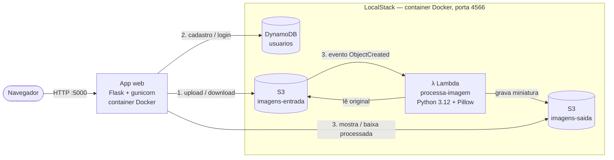

# Galeria de imagens na nuvem (LocalStack)

Computação em Nuvem — 2026/2 · Atividades da aula *LocalStack 2*

Um único sistema que **evolui em três etapas**, uma para cada atividade:

| Etapa | Atividade | O que o sistema ganha | Serviço AWS | Tag no git |
|---|---|---|---|---|
| 1 | Upload/download web | App web envia imagens para um bucket, lista e permite baixar | **S3** | `atividade-1` |
| 2 | Contas e autenticação | Cadastro e login; cada usuário vê só as próprias imagens | **DynamoDB** | `atividade-2` |
| 3 | Processamento serverless | Cada upload dispara uma função que gera a miniatura em tons de cinza no outro bucket; a galeria mostra o resultado | **Lambda** | `atividade-3` |

Para ver o código de uma etapa específica: `git checkout atividade-1` (ou `-2`, `-3`).

## Arquitetura (etapa final)



**Fluxo completo:**
1. O usuário cria a conta, que é gravada no DynamoDB com a senha em hash, e entra.
2. O upload vai para `imagens-entrada/usuarios/<id-do-usuario>/<arquivo>`.
3. O S3 dispara a Lambda, que grava a miniatura em `imagens-saida/processado/usuarios/<id>/<arquivo>`.
4. A galeria mostra "⏳ processando…" e atualiza sozinha. Quando a miniatura fica
   pronta, ela aparece na tela e pode ser baixada.

## Decisões e justificativas

| Decisão | Por quê |
|---|---|
| **Um sistema que evolui** em vez de três projetos soltos | Cada etapa reaproveita a anterior, como acontece num produto real. A #3 processa justamente as imagens que a #1 envia, separadas por usuário graças à #2. |
| **DynamoDB com chave `email`** | O login busca o usuário pelo e-mail, então a chave primária torna essa busca direta (`get_item`), sem varrer a tabela. `PAY_PER_REQUEST` cobra por uso, sem capacidade fixa. |
| **Senha com hash (scrypt)** | O banco nunca guarda a senha. Se a tabela vazar, as senhas não vazam junto. |
| **`ConditionExpression attribute_not_exists`** | Impede que um segundo cadastro com o mesmo e-mail sobrescreva a conta existente. |
| **Mesma mensagem para e-mail inexistente e senha errada** | Não revela a um atacante quais e-mails têm conta. |
| **Prefixo `usuarios/<id>/` no S3** | Isola os arquivos de cada usuário. O app só lista e baixa dentro do prefixo de quem está logado (menor privilégio). |
| **Lambda (FaaS) acionada por evento** | Só executa quando chega uma imagem: sem upload não há custo nem servidor para manter. O app não precisa saber que o processamento existe (desacoplamento). |
| **Dois buckets** (entrada e saída) | Se a Lambda gravasse no bucket que a dispara, entraria em **loop infinito**. |
| **Pillow empacotada para Linux** | A Lambda roda em Linux x86_64, então o zip precisa do binário certo (`pip --platform manylinux`). |
| **Endpoint via `AWS_ENDPOINT_URL`** | App e Lambda usam `boto3` sem endereço fixo. O mesmo código roda na AWS real sem alteração. |
| **docker-compose** | O ambiente inteiro (LocalStack + app) declarado num arquivo, com um comando para subir. O `docker.sock` montado deixa o LocalStack criar os containers da Lambda. |

## Como rodar

Pré-requisitos: Docker e Python 3.

```bash
# 1. Ambiente Python (aws-cli, boto3, pillow, flask, pytest, moto)
python3 -m venv .venv
.venv/bin/pip install -r requirements-dev.txt

# 2. Subir LocalStack + app web
docker compose up -d --build

# 3. Criar a infraestrutura: buckets (1), tabela (2), Lambda e gatilho (3)
./deploy.sh

# 4. Abrir no navegador
#    http://localhost:5000  → cadastre-se, entre e envie uma imagem
```

Para testar só a Lambda pela linha de comando, sem o app:

```bash
./test.sh                      # gera uma imagem de teste
./test.sh ~/Imagens/foto.jpg   # ou use a sua
```

## Testes automatizados

```bash
.venv/bin/python -m pytest -v
```

São 31 testes que rodam com S3 e DynamoDB simulados em memória (moto), **sem Docker**:

- **Atividade 1:** upload, listagem, download idêntico ao original, 404 para
  arquivo inexistente, rejeição de não-imagens, nome de arquivo malicioso (`../../`).
- **Atividade 2:** cadastro grava no DynamoDB com senha em hash e e-mail normalizado,
  e-mail duplicado, validação de campos, login certo e errado, logout, rotas protegidas,
  e **um usuário não vê nem baixa o arquivo do outro**.
- **Atividade 3 (Lambda):** PNG/JPEG, proporção, imagem pequena não é ampliada, nomes com
  espaço/acento, arquivos ignorados, vários registros por evento, rotação EXIF, não grava
  no bucket de entrada.
- **Integração 1+2+3:** upload pelo app → Lambda → galeria mostra a miniatura e permite
  baixar, sem vazar para outro usuário.

Comandos úteis (mesmo padrão do slide: `aws --endpoint-url`):

```bash
source .venv/bin/activate
export AWS_ACCESS_KEY_ID=test AWS_SECRET_ACCESS_KEY=test AWS_DEFAULT_REGION=us-east-1
E=--endpoint-url=http://localhost:4566

aws $E s3 ls --recursive s3://imagens-entrada/                 # originais
aws $E s3 ls --recursive s3://imagens-saida/                   # processadas
aws $E dynamodb scan --table-name usuarios                     # contas
aws $E logs filter-log-events --log-group-name /aws/lambda/processa-imagem \
    --query 'events[].message' --output text                   # logs da Lambda
docker compose logs -f                                         # logs dos containers
docker compose down                                            # desligar tudo
```

### Versão do LocalStack

O `docker-compose.yml` fixa a **4.14.0**, a última versão Community que roda sem
conta. A partir de 2026 a imagem `latest` exige `LOCALSTACK_AUTH_TOKEN` e sai com
*"License activation failed"*. Para usar a mais nova, crie uma conta em
app.localstack.cloud, coloque o token num arquivo `.env` (já ignorado pelo git) e
rode `LOCALSTACK_VERSION=latest docker compose up -d`.

## Estrutura

```
app/                 app web (Flask): app.py, templates/, Dockerfile
lambda/handler.py    função Lambda que processa a imagem
deploy.sh            cria buckets, tabela, Lambda e gatilho (por atividade)
docker-compose.yml   LocalStack + app web
tests/               testes automatizados (pytest + moto)
test.sh              teste rápido só da Lambda via linha de comando
setup.sh             instala Docker e dependências no Ubuntu/WSL
```
