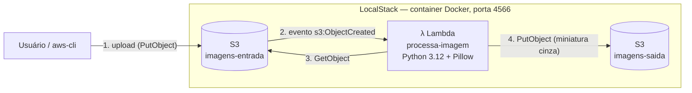

# Atividade #3 — Processamento de imagens com S3 + Lambda (LocalStack)

Computação em Nuvem — 2026/2

Uma função Lambda é **acionada automaticamente** quando uma imagem é enviada ao
bucket `imagens-entrada`. Ela gera uma miniatura (máx. 512 px) em tons de cinza
e grava o resultado no bucket `imagens-saida`, na pasta `processado/`.

## Arquitetura



**Fluxo:**
1. O usuário envia uma imagem para `imagens-entrada`.
2. O S3 publica o evento `ObjectCreated` e invoca a Lambda. A permissão para isso
   foi dada com `lambda add-permission`.
3. A Lambda lê o objeto indicado no evento.
4. Ela processa a imagem (Pillow) e grava em `imagens-saida/processado/<nome>`.

## Por que essas escolhas

| Decisão | Justificativa |
|---|---|
| **Lambda (FaaS)** em vez de um servidor | O processamento só acontece quando chega uma imagem. Sem upload não há execução e não há custo, que é a elasticidade levada ao extremo. Não há SO para manter nem patch para aplicar. |
| **Orientado a eventos** (S3 → Lambda) | Quem faz o upload não precisa saber que existe processamento. Os componentes ficam desacoplados e dá para trocar ou adicionar processamentos sem mexer no upload. |
| **Dois buckets** (entrada e saída) | Se a Lambda gravasse no mesmo bucket, o próprio resultado dispararia a função de novo, criando um **loop infinito** (e, na AWS real, uma conta alta). |
| **Pillow empacotada para Linux** | A Lambda roda em Linux x86_64. A Pillow tem partes em C, então o zip precisa do binário certo (`pip --platform manylinux`), não do binário da máquina do desenvolvedor. |
| **`boto3.client("s3")` sem endpoint fixo** | O LocalStack injeta `AWS_ENDPOINT_URL` no container da função. O mesmo código roda na AWS real sem nenhuma alteração. |
| **docker-compose** em vez de `docker run` | Declara o ambiente num arquivo e monta o `docker.sock`, que o LocalStack precisa para criar os containers onde a Lambda executa. |
| **Miniatura + cinza** | Processamento simples e visualmente verificável. Na vida real o mesmo padrão serve para thumbnails, marca d'água, OCR, compressão etc. |

## Como rodar

Pré-requisitos: Docker e Python 3.

```bash
# 1. Ambiente Python (aws-cli, awslocal, boto3, pillow)
python3 -m venv .venv
.venv/bin/pip install -r requirements-dev.txt

# 2. Subir o LocalStack
docker compose up -d

# 3. Criar buckets, Lambda, permissão e notificação
./deploy.sh

# 4. Testar (sem argumento gera uma imagem de teste; ou passe a sua)
./test.sh
./test.sh ~/Imagens/foto.jpg
```

## Testes automatizados

Os testes rodam a Lambda contra um S3 simulado em memória (moto), **sem precisar
do Docker**. Cobrem PNG/JPEG, proporção, imagem pequena (não amplia), nomes com
espaço/acento, arquivo que não é imagem, vários registros no mesmo evento,
rotação EXIF e a garantia de não gravar no bucket de entrada (evita loop).

```bash
.venv/bin/python -m pytest -v
```

Comandos úteis:

```bash
source .venv/bin/activate
awslocal s3 ls s3://imagens-saida/processado/                  # listar resultados
awslocal logs tail /aws/lambda/processa-imagem                 # logs da função
docker compose logs -f localstack                              # logs do LocalStack
docker compose down                                            # desligar tudo
```

## Estrutura

```
docker-compose.yml   LocalStack com acesso ao Docker (para executar a Lambda)
lambda/handler.py    código da função
deploy.sh            empacota e publica tudo (buckets, função, gatilho)
test.sh              envia uma imagem e baixa o resultado
```
